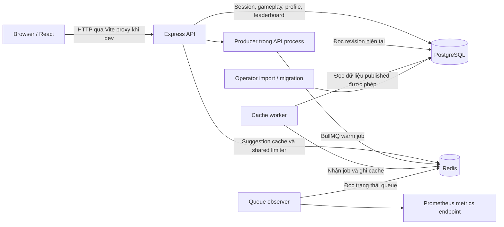

# Loremaster Daily Case — tài liệu bàn giao cho lập trình viên mới

> Cập nhật: **13/10/2026**. Đối tượng: 3 lập trình viên tham gia dự án.
> Baseline: `origin/main` tại `b897f616e9cf0c1cbfe5e0735457c6ee81c4ae11`, đã đối chiếu trực tiếp với GitHub. Tài liệu tổng hợp từ mã nguồn, manifest, kế hoạch và hồ sơ nghiệm thu tại baseline này. Kết quả kiểm thử bên dưới là kết quả lịch sử đã được hồ sơ ghi nhận, không phải một đợt chạy lại toàn bộ hệ thống ngày 13/10.

## 1. Đọc nhanh trong 2 phút

**Loremaster Daily Case là game suy luận hằng ngày trên web**, dùng thế giới và nhân vật hư cấu do dự án tự sáng tác. Người chơi đọc hồ sơ, chọn nhân vật cần tìm, mở dần bằng chứng, rồi xem kết quả, hồ sơ thành tích và bảng xếp hạng ngày.

Dự án có hai mục tiêu: xây một game nhỏ có tính toàn vẹn dữ liệu và tạo bằng chứng thực hành về kiểm thử, đóng gói, vận hành, phục hồi và kiểm soát chi phí. Kubernetes được chọn để học vận hành; đây không phải yêu cầu xuất phát từ quy mô người dùng hiện tại.

Các điểm cần nhớ ngay:

- MVP chỉ có loại câu hỏi **WHO**, chơi bằng guest session, không có tài khoản mật khẩu hay admin UI.
- Monorepo TypeScript: React/Vite, Express, PostgreSQL, Redis/BullMQ.
- PostgreSQL giữ dữ liệu chính thức. Redis chỉ giữ dữ liệu có thể tái tạo; worker chỉ làm nóng cache.
- Domain, database, API và web đã có triển khai và hồ sơ nghiệm thu S1–S6. S7.0–S7.9 đã được merge vào `main` qua PR #13.
- S8.0–S8.5 đã có contract, file secrets và sáu image API/worker/observer/migration/importer/web trên `main` qua PR #14 và #15. Compose và các mục S8.6–S8.11 còn mở; Kubernetes/GitOps và AWS thuộc các giai đoạn sau.
- Việc cấp thiết cho nhóm mới là chạy được baseline local và hoàn thành data services, Compose và nghiệm thu S8 theo thứ tự phụ thuộc.

## 2. Sản phẩm và phạm vi

### Hành trình người chơi

1. Mở trang web; client kiểm tra hoặc tạo guest session.
2. Đọc vụ án hiện tại. Chỉ khi bấm bắt đầu mới tạo lượt chơi và tính thời gian.
3. Chọn một nhân vật hợp lệ từ danh sách gợi ý; đoán đáp án hoặc mở bằng chứng.
4. Kết thúc khi giải đúng, bỏ cuộc, hết lượt hoặc qua thời điểm đóng vụ án.
5. Xem đáp án và lời giải; xem profile, chuỗi ngày tham gia, kiến thức theo vùng và leaderboard.

Giao diện hiện có ba đường dẫn chính: `/`, `/profile`, `/leaderboard`.

### Những luật dễ hiểu sai

- Một ngày chơi là **ngày UTC**: mở lúc 00:00 UTC, đóng lúc 00:00 UTC hôm sau. Tại Việt Nam, mốc này là **07:00**, không phải 00:00 giờ địa phương.
- Briefing là cấp bằng chứng `e=0`; có thêm đúng bốn bằng chứng `e=1..4`.
- Lần đoán sai thứ ba ở một cấp tự mở cấp tiếp theo; sai lần thứ ba ở cấp 4 kết thúc lượt. Tối đa 15 lần đoán sai.
- Mở bằng chứng thủ công chuyển lên một cấp và bỏ các lượt đoán chưa dùng ở cấp cũ. Không thể mở thêm ở cấp 4.
- Refresh hoặc đổi tab không khởi động lại đồng hồ. Thời gian do server/database quyết định.
- Chỉ một lần đoán hợp lệ mới ghi nhận tham gia ngày đó; start, reveal hoặc give-up riêng lẻ không tạo participation.
- Leaderboard chỉ nhận lượt `SOLVED`, xếp theo `(cấp bằng chứng, tổng đoán sai, thời gian)`, không xếp theo tổng điểm. Người có cùng bộ ba nhận cùng hạng.
- Điểm giải đúng dựa trên cấp bằng chứng, trừ `40 × tổng đoán sai`, cộng bonus thời gian; lượt thất bại có điểm 0.
- Khi lượt còn `ACTIVE`, API không trả đáp án, bằng chứng chưa mở, lời giải hoặc nguồn nội bộ. Mọi trạng thái kết thúc đều mở lời giải theo thiết kế.
- Không có vụ án đã publish cho ngày hiện tại là trạng thái hợp lệ `no-case`.

Chi tiết công thức điểm, streak, knowledge và chuyển trạng thái nằm trong [game-rules.md](../architecture/game-rules.md). Đây là nguồn quy tắc chính thức; không suy ra luật từ giao diện.

### Nội dung và các giới hạn hiện tại

Pack mẫu **The Aster Quay ledger** có trong database package, phục vụ kiểm thử và nhập nội dung phía server. Tài liệu `DailyRuneterraCase_Description.md` chỉ là ý tưởng lịch sử; không dùng làm đặc tả triển khai hay nội dung demo. Xem [content-policy.md](../content-policy.md).

Chưa có trong phạm vi MVP: nhiều loại vụ án, khôi phục tài khoản guest, admin UI, nội dung từ IP bên thứ ba chưa được dự án chấp thuận, dịch vụ công khai hoạt động lâu dài, multi-region và tác vụ gameplay bền vững chạy bất đồng bộ. Nếu mở rộng các điểm này, cần thống nhất phạm vi và cập nhật quyết định kiến trúc.

## 3. Kiến trúc hệ thống

### Công nghệ đã có trong repository

| Thành phần                   | Công nghệ / phiên bản được pin                                   |
| ---------------------------- | ---------------------------------------------------------------- |
| Runtime và quản lý workspace | Node.js `22.23.3`, pnpm `11.19.0`, Corepack                      |
| Ngôn ngữ                     | TypeScript `6.0.3`, ES modules                                   |
| Web                          | React `19.3.0`, Vite `8.3.0`                                     |
| HTTP API                     | Express `5.2.1`                                                  |
| Hợp đồng và validation       | Zod `4.6.4`, `@loremaster/contracts`                             |
| Database                     | PostgreSQL; SQL migrations và driver `pg` `8.16.3`, không có ORM |
| Cache và queue               | Redis; BullMQ `5.81.5`, ioredis `5.11.1`                         |
| Kiểm thử                     | Vitest `5.0.0`, Supertest, Playwright `1.63.0`, axe              |
| Chất lượng và CI             | ESLint, Prettier, GitHub Actions, dependency audit, Gitleaks     |

PostgreSQL `17.6` và Redis `7.4.5` được dùng trong harness với image pin bằng digest. Điều này chưa đồng nghĩa các image runtime S8 đã được lựa chọn và nghiệm thu.

### Sơ đồ runtime hiện có



Đây là monorepo với các module dùng chung và bốn app, không phải bốn microservice cùng ghi dữ liệu game. Producer chạy cùng API nhưng có quyền và kết nối riêng. Sơ đồ chưa mô tả một stack Compose/Kubernetes đã triển khai.

### Trách nhiệm và ranh giới module

| Đường dẫn                                            | Trách nhiệm / nơi bắt đầu đọc                                             |
| ---------------------------------------------------- | ------------------------------------------------------------------------- |
| `apps/web/src/main.tsx`, `app.tsx`                   | Khởi tạo React, bố cục và điều hướng                                      |
| `apps/web/src/gameplay/`, `profile/`, `leaderboard/` | Các màn hình sản phẩm                                                     |
| `apps/web/src/api/`, `session/`, `state/`            | HTTP client, bootstrap session, retry và đồng bộ trạng thái               |
| `apps/api/src/index.ts`, `server.ts`, `app.ts`       | Khởi động process, composition và HTTP middleware                         |
| `apps/api/src/routes/`, `security/`                  | Gameplay/reporting; auth, Origin, CSRF, cookie, rate limit                |
| `packages/contracts/src/api.ts`, `schemas.ts`        | Endpoint, request/response schema và mã lỗi công khai                     |
| `packages/domain/src/`                               | Luật thuần: state machine, score, aggregate, leaderboard, projection      |
| `packages/database/src/gameplay/`, `identity/`       | SQL repositories, transaction, session và các hiệu ứng gameplay           |
| `packages/database/src/content/`, `migrations/`      | Validation/import pack và thay đổi schema                                 |
| `packages/cache/src/`                                | Adapter Redis, suggestion index, limiter và connection policy phía server |
| `packages/queue/src/`                                | Job contract, producer, worker logic, bảo vệ Redis scripts                |
| `apps/worker/src/index.ts`                           | Process chạy cache worker, probes và shutdown                             |
| `apps/queue-observer/src/index.ts`                   | Process đọc queue, probes và `/metrics`                                   |
| `packages/config/`, `observability/`                 | Parse cấu hình, deadline/probe hỗ trợ, log và metrics có giới hạn         |
| `tests/`, `scripts/`                                 | Test suite và harness database/Redis/browser                              |
| `plans/`, `docs/adr/`, `docs/architecture/`          | Kế hoạch, quyết định kiến trúc và bằng chứng nghiệm thu                   |
| `ops/redis/`, `ops/cost/`                            | ACL/hash inventory Redis và chính sách admission AWS                      |
| `deploy/images/`                                     | Sáu Dockerfile, operator entrypoint và contract image S8                  |
| `platform/`, `infra/`                                | Ranh giới dành cho local Kubernetes và cloud về sau                       |

**Ranh giới browser đặc biệt quan trọng:** web chỉ phụ thuộc workspace package `@loremaster/contracts`. Không import domain, database, cache, queue, fixture hoặc cấu hình server vào web. Contracts chỉ chứa dữ liệu được phép công khai. `packages/cache` cũng không phụ thuộc app, database, queue hay browser contracts; dùng các port được inject để giữ dependency đúng chiều.

### Một request đoán đáp án đi qua đâu?

1. Web tạo command với `expectedVersion` và một `Idempotency-Key`; gửi cookie, Origin và CSRF token.
2. API áp dụng policy/auth/CSRF/rate limit, kiểm tra JSON có giới hạn và schema trong contracts.
3. Route gọi repository phía database, không tự tính điểm trong handler.
4. Transaction giữ thứ tự lock guest profile trước attempt, xử lý receipt của retry và kiểm tra ownership, thời gian, version.
5. Domain tính chuyển trạng thái. Database commit guess, receipt và các hiệu ứng cần thiết như finalization, participation, knowledge, leaderboard trong cùng transaction.
6. API chỉ trả projection được phép và validate response theo contract. Web cập nhật từ kết quả server.

Một thao tác timeout có thể đã commit. Client phải giữ và retry đúng key/payload, không tạo key mới chỉ vì chưa nhận được response. Key giống nhau với payload khác phải conflict; command mới dùng version cũ cũng phải conflict. Xem `apps/web/src/api/pending-operation.ts` và `packages/database/src/gameplay/attempts.ts`.

### Mô hình dữ liệu và cache

| Nhóm                   | Bảng / dữ liệu chính                                                                                                                        |
| ---------------------- | ------------------------------------------------------------------------------------------------------------------------------------------- |
| Nội dung               | `content_packs`, `case_revisions`, `case_entities`, `entity_aliases`, `case_evidence`, `case_sources`, `region_catalog`, `revision_regions` |
| Danh tính              | `guests`, `guest_sessions`; database lưu hash guest token                                                                                   |
| Lượt chơi              | `attempts`, `guesses`, `command_receipts`                                                                                                   |
| Hiệu ứng và thành tích | `attempt_finalizations`, `participation_days`, `knowledge_contributions`, `regional_knowledge`, `leaderboard_entries`                       |
| Redis                  | Suggestion index theo revision, limiter counter và BullMQ state; không chứa game truth                                                      |

Published revision là bất biến; attempt gắn với đúng revision đó. Cửa sổ published không được chồng nhau. Runtime, importer, migration owner, cache producer và cache worker có quyền riêng; runtime API không được dùng tài khoản owner.

Queue chỉ có job `warm-current-revision-v1`, mang version và revision ID với danh tính job xác định. Producer chọn revision bằng thời gian PostgreSQL khi startup/reconnect và theo chu kỳ 60 giây; không enqueue như điều kiện để commit gameplay. Suggestion phải kiểm tra quyền trong PostgreSQL trước khi đọc Redis, và không gọi Redis trong transaction PostgreSQL.

Khi Redis hỏng, suggestions quay về PostgreSQL, gameplay vẫn dùng PostgreSQL và local rate limiter vẫn hoạt động. Shared limiter bị suy giảm; nhiều API replica có thể cho phép tổng hạn mức local của từng replica. Đây là giới hạn đã được thiết kế và cần giữ khi đóng gói.

## 4. Tiến độ thực tế

### Cách hiểu trạng thái

Mã tồn tại trong thư mục, test được hồ sơ ghi là PASS và thay đổi đã merge vào `main` là ba thông tin khác nhau. Không dùng số lượng checkbox để suy ra tỷ lệ hoàn thành hay kết luận sẵn sàng production.

Khảo sát ban đầu ngày 12/10/2026 dùng working tree của `codex/s7-completion` tại `2cf1b1e`. Bản cập nhật ngày 13/10 đối chiếu baseline `origin/main` tại `b897f61` với remote GitHub và dùng nội dung đã commit trên main để xác định trạng thái. Lịch sử Git xác nhận PR #13, #14 và #15 đã merge; lần cập nhật này không chạy lại toàn bộ CI hay các gate container.

| Giai đoạn  | Phần việc                                                      | Trạng thái có thể kết luận từ repository                                                                                                                                                                      |
| ---------- | -------------------------------------------------------------- | ------------------------------------------------------------------------------------------------------------------------------------------------------------------------------------------------------------- |
| S1         | Phạm vi, luật, ADR, content policy, threat model               | Có baseline và [nghiệm thu S1](../architecture/s1-acceptance.md)                                                                                                                                              |
| S2         | Monorepo, toolchain, lệnh kiểm tra                             | Có triển khai và [nghiệm thu S2](../architecture/s2-acceptance.md)                                                                                                                                            |
| S3         | CI cho PR, audit và secret scan                                | Có workflow và [nghiệm thu S3](../architecture/s3-acceptance.md)                                                                                                                                              |
| S4         | Domain, schema, importer, transaction                          | Có triển khai và [nghiệm thu S4](../architecture/s4-acceptance.md)                                                                                                                                            |
| S5         | API, session/security, hợp đồng HTTP                           | Có triển khai và [nghiệm thu S5](../architecture/s5-acceptance.md)                                                                                                                                            |
| S6         | Web gameplay, profile, leaderboard, recovery, accessibility    | [Nghiệm thu S6](../architecture/s6-acceptance.md) ghi đã merge PR #7 và hosted CI PASS                                                                                                                        |
| S7.0–S7.6  | Cache/queue contracts, Redis, producer, worker, shared limiter | [Kế hoạch S7](../../plans/s7-cache-worker.md#progress) và [runtime evidence](../../plans/s7-runtime.md) ghi đã merge PR #8, #9, #12                                                                           |
| S7.7–S7.9  | Probes, observer, composed failure tests, bàn giao             | Đã merge [PR #13](https://github.com/JasonHo20004/loremaster/pull/13) tại `e41cab1`; [hồ sơ S7](../architecture/s7-acceptance.md) giữ bằng chứng runtime                                                      |
| S8.0–S8.5  | Preflight, file secrets, contract và sáu container images      | Đã merge [PR #14](https://github.com/JasonHo20004/loremaster/pull/14) và [PR #15](https://github.com/JasonHo20004/loremaster/pull/15); [image evidence](../../plans/s8-images-evidence.md) ghi các gate local |
| S8.6–S8.11 | Data services, Compose, recovery và full-stack acceptance      | Còn mở trong [kế hoạch S8](../../plans/s8-containers.md#progress); chưa có stack Compose được nghiệm thu                                                                                                      |
| S9         | Local kind, Helm, Argo CD, GitOps                              | Lộ trình; chưa có triển khai trong checkout                                                                                                                                                                   |
| S10        | Observability toàn hệ thống và release gate                    | Lộ trình; probes/metrics S7 chưa thay thế giai đoạn này                                                                                                                                                       |
| S11–S12    | AWS bootstrap, cleanup qualification, lab và teardown          | Lộ trình có điều kiện; cloud đang DENIED trong hồ sơ admission                                                                                                                                                |

### Bằng chứng kiểm thử đã ghi nhận

[Hồ sơ S7 ngày 01/10/2026](../architecture/s7-acceptance.md#final-local-gate-results-2026-10-01) ghi: full verify với **369 tests và 11 workspace builds**, **93 database tests**, **7 API/PostgreSQL tests**, **8 Redis scenarios**, **9 composed scenarios**, **4 real-stack và 5 shell/accessibility journeys**, **11 Chromium component tests**. Số lượng này là snapshot lịch sử; các suite có thể trùng phạm vi, không cộng thành tổng coverage và không coi là kết quả của checkout hiện tại.

Workflow Quality hiện chạy verify, S7 contracts, S8 image policy/file secrets/proxy contract, database, API/database, Redis và composed S7. Job S8 image validation riêng chạy `pnpm test:images`, gồm build, browser journey qua gateway và artifact scan. Các gate browser host-development và disclosure cũng có lệnh riêng; đọc workflow và kết quả từng run để biết một PR đã thực sự chạy những gì.

### Hồ sơ cũ cần đọc theo thời điểm

[S8 preflight ngày 02/10](../../plans/s8-preflight.md) thay thế lần kiểm tra bị chặn ngày 29/09 sau khi S7 được merge vào main. [Image evidence ngày 11/10](../../plans/s8-images-evidence.md) ghi các gate local của sáu image và Node pin mới `22.23.3`. Các bằng chứng này có ngày và phạm vi riêng; trước khi tiếp tục S8.6, kiểm tra baseline, toolchain và kết quả hosted CI tương ứng, rồi chạy lại gate cần thiết trên máy của nhóm.

## 5. Công việc còn lại và thứ tự ưu tiên

### P0 — Chốt nền tảng bàn giao

- Dùng main đã đồng bộ làm baseline; bản khảo sát này ghi `b897f61`, bao gồm PR #13, #14 và #15. Kiểm tra hosted CI tại commit nhóm chọn trước khi tiếp tục delivery.
- Giữ checkout sạch và branch riêng cho task mới; đối chiếu mọi thay đổi local với baseline chung.
- Mỗi người có clone/branch riêng, đúng Node/pnpm, Docker Linux daemon và Chromium cần cho test.
- Chạy lại các gate bắt buộc trên checkout sạch; ghi bằng chứng môi trường nhóm trước khi bắt đầu S8.6.
- Làm rõ quy trình cấp local database, role/login và content pack để người mới không phụ thuộc vào database trên máy tác giả.

### P1 — S8: stack local có thể tái tạo

Thực hiện theo [kế hoạch S8](../../plans/s8-containers.md), không bắt đầu từ Kubernetes:

1. **S8.0–S8.2 đã có:** đọc preflight, base-image digest/build-context allowlist/scanner policy, file secrets và contract gateway/Origin/source IP; chạy lại các focused gate.
2. **S8.3–S8.5 đã có:** build và kiểm tra sáu image API/worker/observer/migration/importer/web từ baseline nhóm chọn. Giữ các ranh giới image và đối chiếu artifact evidence trước khi composition.
3. **S8.6–S8.7:** bootstrap PostgreSQL/Redis với quyền riêng, persistence/ACL, Compose networks/resources; mặc định chỉ công bố gateway `http://localhost:8080`.
4. **S8.8–S8.9:** kiểm chứng probes, shutdown, restart, dependency outage và browser E2E từ volumes sạch.
5. **S8.10–S8.11:** scan artifact đã đóng gói, SBOM/vulnerability/secret gate, cập nhật acceptance và bàn giao S9.

Hai mục nghiệm thu còn thiếu cần theo dõi cụ thể:

- **B13:** kiểm tra public image, layers, source maps và response thực tế không chứa dữ liệu private. Scan source/Vite dist hiện có chưa đủ để đóng mục này ở S8.
- **T25:** bằng chứng quan sát qua thời điểm đóng ngày trong stack đóng gói, khi người chơi chưa start, không tự sinh attempt hay hiệu ứng profile. S4 đã có test repository; bằng chứng tích hợp theo lịch vẫn thuộc S8.

Các lệnh `test:s8:image-policy`, `test:s8:secrets`, `test:s8:proxy-contract`, `build:images`, `test:images` và các gate image riêng đã có trong root `package.json`. Xem [image contract](../../deploy/images/README.md) trước khi chạy; chúng cần toolchain/Docker/Buildx/browser thích hợp và dùng dependencies disposable, chưa cung cấp Compose stack lâu dài.

### P2 — Sau khi S8 được nghiệm thu

- **S9:** local Kubernetes bằng kind, Helm/Argo CD, desired state, drift repair và recovery; giữ nguyên các contract đã đo ở S8.
- **S10:** telemetry pipeline, retention, dashboard/cảnh báo và release gate có bằng chứng. Queue observer hiện có chỉ là một phần đầu vào.
- **S11:** bootstrap cloud và chứng minh cleanup độc lập với cluster trước khi có runtime lab.
- **S12:** chỉ chạy AWS lab khi đủ technical/cost admission, kiểm tra isolation và teardown đúng tài nguyên.

AWS chưa được cấp admission. Số credit và thời hạn trong `ops/cost/` là dữ liệu kế hoạch lịch sử, không phải xác nhận số dư hiện tại. Nhóm không dùng chúng để tự apply cloud; xem [chính sách admission](../../ops/cost/README.md) và ledger của dự án.

### Hạng mục sản phẩm nên trao đổi với chủ dự án

Đây là đề xuất cho backlog, chưa phải cam kết phạm vi: thêm pack nguyên bản để lấp lịch chơi, quy trình biên tập/publish có người chịu trách nhiệm, cải thiện UX từ feedback thực tế và quyết định có cần bản dịch giao diện hay không. Hiện chưa có content workflow qua admin UI. Ước lượng thời gian chỉ nên làm sau khi nhóm chạy baseline và xác nhận mức ưu tiên giữa sản phẩm với mục tiêu vận hành.

## 6. Đề xuất phân việc cho 3 lập trình viên

Chia theo ranh giới hiện có để giảm xung đột. Đây là phương án bàn giao, chưa gán cho người cụ thể.

| Vai trò                           | Sở hữu chính                                                                 | Việc đầu tiên                                               | Đầu ra tiếp theo                                                  |
| --------------------------------- | ---------------------------------------------------------------------------- | ----------------------------------------------------------- | ----------------------------------------------------------------- |
| LTV 1 — Web và public gateway     | `apps/web/`, browser tests, image/config gateway đã có                       | Chạy game và gateway journey; hiểu session/retry/disclosure | Browser proof qua Compose, B13 và public deployed-artifact checks |
| LTV 2 — Backend và dữ liệu        | `apps/api/`, `packages/domain/`, `packages/database/`, operator images đã có | Trace command/retry và kiểm tra migration/import operator   | PostgreSQL provisioning, quyền/volume và bootstrap dữ liệu S8.6   |
| LTV 3 — Cache và đóng gói runtime | Worker/observer, cache/queue, Node images và topology tích hợp               | Chạy Redis/composed gate; hiểu fallback/probes/ACL          | Redis data service S8.6, Compose S8.7 và lifecycle evidence       |

`packages/config/`, `packages/contracts/`, root scripts, lockfile, CI và Compose manifests là điểm dễ đụng nhau. Mỗi thay đổi cần một người sở hữu PR; hai người còn lại review hoặc cung cấp commit đã thống nhất. Riêng LTV 2 và LTV 3 cần thống nhất API binding/shutdown trước khi đóng gói API.

**Nhịp tích hợp:** cả nhóm tái kiểm chứng baseline S8.0–S8.5 đã có; LTV 2 và LTV 3 phối hợp data services S8.6, chốt một người tích hợp Compose S8.7 rồi cả nhóm cung cấp test cho S8.8–S8.11. Không cho ba người cùng sửa manifest tích hợp độc lập. Mỗi task nên có phạm vi file, điều kiện phụ thuộc, tiêu chí hoàn thành, lệnh kiểm tra và cách rollback.

## 7. Thiết lập môi trường và chạy local

### Toolchain và checkout

Hướng dẫn chuẩn hiện tại chọn **WSL2/Linux**, clone trong filesystem WSL để tránh file watcher chậm và khác biệt permission. Cần Git, Node `22.23.3`, pnpm `11.19.0` qua Corepack và Docker Linux daemon cho integration tests.

Chạy từ repository root trong WSL/bash; `nvm` cần được cài sẵn:

```bash
nvm install
nvm use
corepack enable
corepack install
pnpm install --frozen-lockfile
pnpm run verify
```

Dùng **`pnpm run verify`**, vì pnpm 11 có một built-in `verify` khác. Không nâng phiên bản để né lỗi shim. Nếu pnpm gọi đến đường dẫn global đã mất, sửa launcher theo [development guide](README.md).

### Điều kiện trước khi mở web

1. Có PostgreSQL local đã chạy migrations bằng migration owner.
2. Có login runtime chỉ nhận group role `loremaster_runtime` và login importer riêng.
3. Có pack đã publish cho **ngày UTC hiện tại**. Fixture Aster Quay mặc định dùng slot `2030-01-01`; nhập nguyên mẫu sẽ không tạo vụ án hôm nay. Chuẩn bị pack local với `slotId`, `opensAt`, `closesAt` nhất quán trước khi publish; không sửa revision đã publish.

Repository có thư viện `migrateToLatest` trong `packages/database/src/migrate.ts`, harness test tự bootstrap database và migration/importer images S8.4. Operator entrypoint được đóng gói cho image, nhận database URL từ secret file và chạy riêng với quyền thích hợp; xem [image contract](../../deploy/images/README.md). Chưa có `pnpm db:migrate` hay Compose startup cho developer; LTV 2 cần bàn giao bootstrap data services S8.6 và không gắn migration vào API startup.

Importer hiện có lệnh chạy thật, với JSON pack nằm phía operator/server:

```bash
export LOREMASTER_IMPORT_DATABASE_URL='postgresql://<import-login>:<password>@127.0.0.1:5432/<database>'
pnpm content:import -- --file /absolute/path/case.json --dry-run
pnpm content:import -- --file /absolute/path/case.json
```

Chỉ publish sau khi dry-run thành công. Giới hạn input 256 KiB; exit code `0` là thành công, `2` là lỗi input/slot/revision, `3` là lỗi kết nối/quyền. Xem [content-import.md](content-import.md).

### API và web trong hai terminal

Terminal API, thay placeholder bằng cấu hình riêng của máy:

```bash
export LOREMASTER_API_MODE=local
export DATABASE_URL='postgresql://<runtime-login>:<password>@127.0.0.1:5432/<database>'
export LOREMASTER_API_ORIGIN='http://localhost:5173'
export LOREMASTER_API_CURSOR_ACTIVE_VERSION='local-v1'
export LOREMASTER_API_CURSOR_ACTIVE_KEY='<base64url-random-32-byte-key>'
export PORT=3000
pnpm --filter @loremaster/api dev
```

Tạo cursor key riêng bằng lệnh sau, giữ giá trị ngoài Git:

```bash
node -e "process.stdout.write(require('node:crypto').randomBytes(32).toString('base64url') + '\n')"
```

Terminal web:

```bash
export LOREMASTER_API_PROXY_TARGET='http://127.0.0.1:3000'
pnpm --filter @loremaster/web dev
```

Mở `http://localhost:5173`. Vite proxy giữ nguyên Origin của browser; không đổi Origin API sang `http://127.0.0.1:3000`. Các ví dụ trên dùng biến môi trường shell; PowerShell phải dùng cú pháp `$env:NAME = 'value'`.

Redis mặc định tắt. Bắt đầu bằng API/web/PostgreSQL, sau đó bật Redis theo [ops/redis/README.md](../../ops/redis/README.md) với đầy đủ URL/ACL/HMAC riêng cho từng process; không dùng chung một Redis admin URL cho mọi app.

Ví dụ shell trên là local host-development. Container production mode bắt buộc dùng secret files; local HTTP gateway có profile riêng. Đọc [S8 container environment contract](s8-container-contract.md) để cấu hình `*_FILE`, binding và trusted proxy đúng môi trường.

| Process        | Binding mặc định | Kiểm tra                                                        |
| -------------- | ---------------- | --------------------------------------------------------------- |
| Web dev        | `localhost:5173` | Gameplay/profile/leaderboard qua browser                        |
| API            | `127.0.0.1:3000` | `/health/live`, `/health/ready`; readiness phụ thuộc PostgreSQL |
| Worker         | `127.0.0.1:3001` | live/ready; readiness phụ thuộc PostgreSQL và queue/cache Redis |
| Queue observer | `127.0.0.1:3002` | live/ready, `/metrics`; readiness phụ thuộc Redis               |

## 8. Kiểm tra và quy tắc làm việc

### Lệnh hiện có

| Lệnh từ repository root                        | Mục đích / prerequisite                                                                                        |
| ---------------------------------------------- | -------------------------------------------------------------------------------------------------------------- |
| `pnpm run verify`                              | Format, lint, typecheck, non-database/non-Redis tests và build; chưa bao gồm toàn bộ integration/browser gates |
| `pnpm test:database`                           | Migrations, constraints, transaction/roles; cần Docker                                                         |
| `pnpm test:api:database`                       | HTTP API với PostgreSQL thực; cần Docker                                                                       |
| `pnpm test:s7:contracts`                       | Cache/queue/config/limiter và dependency/script boundary                                                       |
| `pnpm test:redis`                              | Redis ACL, cache, producer/worker, limiter; cần Docker                                                         |
| `pnpm test:s7:integration`                     | API/worker/observer với PostgreSQL/Redis và lỗi dependency; cần Docker                                         |
| `pnpm test:s8:image-policy`                    | Static image policy, build-context và scanner policy                                                           |
| `pnpm test:s8:secrets`                         | File-secret parsing, permission và cấu hình                                                                    |
| `pnpm test:s8:proxy-contract`                  | Local gateway/Origin/trusted-proxy contract                                                                    |
| `pnpm test:images`                             | Build sáu images, behavior/browser journey và artifact scan; cần Docker/Buildx/Chromium                        |
| `pnpm --filter @loremaster/web test:component` | Component tests chạy Chromium                                                                                  |
| `pnpm test:web:e2e`                            | Browser journeys, gồm real stack; cần Docker và Playwright Chromium                                            |
| `pnpm test:web:disclosure`                     | Build và scan public artifacts                                                                                 |
| `pnpm audit --audit-level moderate`            | Dependency audit cần truy cập registry                                                                         |

Nếu máy chưa có browser tương ứng, cài bằng `pnpm exec playwright install chromium`; Linux có thể cần thêm OS dependencies. Thiếu Docker/browser/database là prerequisite thất bại, không được bỏ qua rồi ghi PASS.

### Quy ước và Definition of Done

- Dùng strict TypeScript/ES modules, formatter/linter của repository. Code hiện dùng tên file kebab-case, tests `*.test.ts`/`*.spec.ts`, Prettier không semicolon và dùng single quotes.
- Luật thuần đặt ở domain; SQL/transaction đặt ở database; HTTP/security đặt ở API; web hiển thị state do server xác nhận.
- Sửa hành vi phải có test ở đúng tầng, nhất là concurrency, expiry, retry hoặc disclosure; thay đổi docs/format không cần thêm test mô phỏng việc chỉnh tài liệu.
- Thay contract phải review tác động cả API và web. Quyết định kiến trúc mới cần ADR; migration đã deploy phải sửa bằng forward migration mới.
- Không log token, URL có credentials, payload nội dung, đáp án, SQL parameters hay lỗi driver thô. Không đưa secret vào biến `VITE_*`.
- Không cache chung response có danh tính người chơi. Không chuyển score/finalization sang queue và không bỏ local limiter khi có Redis.
- PR có mục đích, phạm vi, bằng chứng kiểm tra, hạn chế và rollback. Theo kế hoạch slice, dùng branch `codex/<slice-name>`; commit hiện chủ yếu theo kiểu `feat:`, `fix:`, `docs:`.
- Hoàn thành nghĩa là focused gates và kiểm tra bắt buộc PASS, review xong, tài liệu/status cập nhật, hosted CI PASS trên head cuối và merge đúng baseline. Lệnh chạy local thành công không thay thế delivery evidence.

## 9. Kế hoạch làm quen trong tuần đầu

| Thời điểm | Cả nhóm                                                                             | Kết quả cần có                                                          |
| --------- | ----------------------------------------------------------------------------------- | ----------------------------------------------------------------------- |
| Ngày 1    | Đọc tài liệu này, game rules, ADR; xác nhận baseline và môi trường                  | Ghi được branch/commit chung, tool versions và blocker                  |
| Ngày 2    | Chạy API/web; thử refresh, reveal, give-up, profile; chạy focused gate theo vai trò | Mỗi người giải thích được một luồng request và ranh giới mình phụ trách |
| Ngày 3    | Review retry, ownership, disclosure, role/ACL; đối chiếu S7 và S8 preflight         | Danh sách gap có owner; không còn nhầm mã có sẵn với phần đã nghiệm thu |
| Ngày 4–5  | Hoàn thành một task nhỏ đúng phạm vi, review chéo; ghi gate của baseline S8.0–S8.5  | PR đầu tiên có bằng chứng; backlog data services/Compose được chia rõ   |

Đây là lịch làm quen đề xuất, không phải deadline cam kết cho S8.

### Chẩn đoán nhanh khi gặp vướng mắc

| Hiện tượng                                      | Kiểm tra trước                                                                                          |
| ----------------------------------------------- | ------------------------------------------------------------------------------------------------------- |
| Web báo no-case                                 | Slot UTC hiện tại, pack đã publish chưa; fixture mẫu đang ở năm 2030                                    |
| Mutation bị 403                                 | Origin có đúng `localhost:5173`, cookie/CSRF và proxy config; không bỏ security để sửa nhanh            |
| Mutation bị 409                                 | `expectedVersion` cũ hoặc reuse idempotency key với payload khác; refresh/reconcile theo client hiện có |
| API readiness lỗi                               | PostgreSQL URL, role runtime, migrations, deadline; API không tự migrate                                |
| Redis tắt nhưng game vẫn chơi được              | Fallback là hành vi được thiết kế; kiểm tra shared limiter degraded và suggestions fallback             |
| Worker/observer không khởi động                 | Biến môi trường/ACL đúng process, role URL riêng; xem Redis inventory                                   |
| Verify PASS nhưng browser/integration chưa chạy | Chạy các gate riêng trong bảng lệnh, xem workflow thực tế                                               |
| pnpm lỗi đường dẫn global                       | Version/shim và PATH; không sửa pin hoặc lockfile tùy tiện                                              |

## 10. Thứ tự đọc và các quyết định cần chủ dự án chốt

Đọc theo thứ tự: [game rules](../architecture/game-rules.md) → [architecture](../architecture/README.md) → [ADR index](../adr/README.md) → [S5 API contract](../architecture/s5-api-contract.md) → [local development](README.md) → [S7 acceptance](../architecture/s7-acceptance.md) → [S8 plan](../../plans/s8-containers.md). Khi sửa security/content, đọc thêm [threat model](../threat-model/README.md) và [content policy](../content-policy.md).

Trước khi giao sprint đầu tiên, chủ dự án cần xác nhận: commit bàn giao cuối, owner/reviewer từng phần, cách bootstrap database local, lịch nội dung có người phụ trách, ưu tiên giữa game và vận hành, và mốc nghiệm thu mong muốn. Repository chưa cung cấp bằng chứng để kết luận số người dùng thực tế, môi trường production đang chạy hay ngày phát hành đã cam kết.

Khi cập nhật tài liệu này, giữ ngày khảo sát và baseline rõ ràng; thay trạng thái bằng link tới acceptance/CI/merge evidence mới. Không biến đề xuất phân việc hoặc lộ trình tương lai thành tuyên bố tính năng đã hoàn thành.
